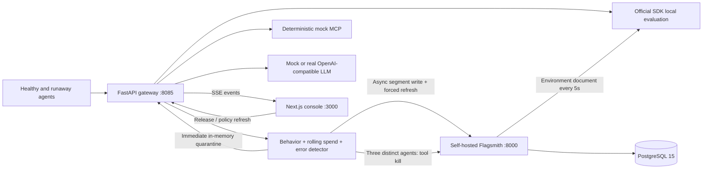

# AgentBreaker

Start here: [configuration and integration guide](docs/CONFIGURATION.md). It explains which settings you change, which keys bootstrap generates, how to connect an existing agent, and the current deployment limits.

**Let agents run. Keep control.** A self-hosted AI agent and MCP runtime gateway that detects runaway behavior, quarantines the offending agent, and routes it to a cheaper model while healthy agents keep working. Flagsmith is the authoritative control plane, with official Python SDK local evaluation on every permitted request.

Built for [Toggle Wars — Track 3: Build on Open Source Flagsmith](https://www.wemakedevs.org/hackathons/flagsmith). MIT licensed. No paid API keys required.

**Release status: tested local prototype.** The gateway uses real Flagsmith enforcement. It currently supports two named tools and non-streaming LLM calls. Authentication, generic MCP transport, and shared state for replicas are not implemented; do not expose this release's admin API publicly.

## Three-step quickstart

Prerequisites: Docker Desktop / Docker Compose v2.24+, Python 3.13+, Node 22+ for host dashboard checks, and Make (or use the PowerShell commands below).

1. Install the Python tools: `python -m pip install -e "./gateway[dev]"`.
2. Start and provision the stack: `make up`.
3. Run the competing agents: `make demo`. Open the [dashboard](http://localhost:3000), [gateway API docs](http://localhost:8085/docs), and [Flagsmith](http://localhost:8000).

Run commands from `agentbreaker/`. `make test` runs unit tests and live verification. First startup downloads images, builds the dashboard, and applies Flagsmith database migrations; allow several minutes.

If port 3000 is in use, set `DASHBOARD_PORT=3001` in `.env` and open `http://localhost:3001`. This machine uses that override to preserve the existing app on 3000. The gateway allows both local dashboard origins by default.

### Windows PowerShell without Make

```powershell
python -m pip install -e './gateway[dev]'
python scripts/configure.py
docker compose up -d --build postgres flagsmith mock-mcp mock-llm
python scripts/bootstrap_flagsmith.py
docker compose up -d --build gateway dashboard
python demo/run_demo_agents.py
python scripts/verify_e2e.py
```

Local Flagsmith login: `admin@agentbreaker.local` / `AgentBreakerDemo123!`. Override both with `FLAGSMITH_ADMIN_EMAIL` and `FLAGSMITH_ADMIN_PASSWORD` in an ignored `.env`. The requested demo password resembles its email, so the current image rejects REST registration. Bootstrap attempts REST first, then creates the account with Django inside this Compose service. Password validators remain enabled. All organisation, project, environment, key, flag, segment, override, and health-provider operations use live REST APIs.

Bootstrap is idempotent: named resources are reused, current quarantine and operator policies are preserved, and saved master secrets are validated before reuse. If `.env.runtime` is lost, an orphaned gateway master key is revoked and replaced. Bootstrap checks the live schema at `/api/v1/swagger.json`, which the current image advertises from `/api/v1/docs/`. It writes resolved credentials atomically to ignored `.env.runtime`; never publish this file.

## Architecture



### The control loop

* Every MCP request includes `X-Agent-Id` and optionally `X-Tenant-Id`. Missing headers use `anonymous-agent` and `default-tenant`. IDs accept safe identifier characters, excluding commas to prevent segment-rule injection.
* The SDK loads a real environment document with a server-side key and `enable_local_evaluation=True`, polling every five seconds. No control-plane network call happens during request evaluation. If the document is absent or older than 30 seconds, the gateway fails closed with HTTP 503.
* Three identical canonical tool calls in 30 seconds, or two full A-B cycles, immediately quarantine that agent. Its third/fourth triggering call is never forwarded. Every tool is blocked locally during quarantine; the persisted segment disables `charge_card` and selects the fallback LLM route.
* Background write-back merges agent IDs into the Flagsmith `agentbreaker_quarantined` segment, preserving nested rule/condition IDs and other quarantined members. Failed synchronization retries every five seconds. Startup restores persisted members before serving traffic.
* Token and USD spend roll over 60 seconds per agent. A completion that crosses a cap is recorded and quarantines the agent; with default `fail_closed:true`, further LLM requests are blocked until the window expires or an operator releases quarantine. Setting `fail_closed:false` keeps those LLM requests on the cheap fallback route while tools stay quarantined. Already incurred cost cannot be undone. USD values are estimates using configured model-family rates in `llm_proxy.py`, not billing data.
* Consecutive upstream failures quarantine one agent. Errors from at least three distinct agents within 60 seconds disable the affected global tool or LLM flag. A single noisy agent cannot disable everyone. The threshold uses distinct agent IDs, including agents sharing a tenant, as required by the runtime escalation rule. Agent IDs are trusted inputs in this local demo.
* Release commits the persisted removal and forces an SDK refresh before clearing memory and behavioral history. If persistence fails, quarantine stays engaged. Global kill switches require an operator to re-enable the relevant flag in Flagsmith.
* Feature Health receives an `unhealthy` webhook with a structured reason. When unavailable, incident metadata is persisted in the quarantine segment description. Health alerts are informational and never flip environment flags themselves.

### Flags and live experimentation

| Flag / segment | Purpose |
| --- | --- |
| `mcp_tool_charge_card` | Global tool kill, with quarantined segment override disabled |
| `mcp_tool_query_inventory` | Independently controlled inventory tool kill |
| `llm_model_route` | JSON model, max token, tier, optional prompt, and fallback model config |
| `breaker_policy_config` | Live validated policy: loop thresholds, windows, spend, token and error caps |
| `agentbreaker_quarantined` | `ALL → ANY → agent_id IN comma-separated IDs` |

`llm_model_route` defaults to `{"model":"gpt-4o","max_tokens":1024,"tier":"primary"}`. Its multivariate fallback option starts at zero percent. Increase the allocation in Flagsmith to canary a model without a deployment. Quarantine overrides select `gpt-4o-mini`, 256 max tokens, fallback tier. Optional `prompt` prepends a system message, and `fallback_model` controls retry routing. Unknown policy fields and invalid thresholds fail closed.

## Use with an agent

```python
import httpx

response = httpx.post('http://localhost:8085/mcp', headers={
    'X-Agent-Id': 'my-agent', 'X-Tenant-Id': 'my-team',
}, json={
    'jsonrpc': '2.0', 'id': 1, 'method': 'tools/call',
    'params': {'name': 'query_inventory', 'arguments': {'sku': 'sku-123'}},
})
print(response.json())
```

For an OpenAI client, set `base_url="http://localhost:8085/v1"`, use a dummy local API key if the client requires one, and pass `X-Agent-Id` as an extra header. The gateway chooses the model and max tokens from Flagsmith. Responses include `X-AgentBreaker-Model`, `X-AgentBreaker-Tier`, and `X-AgentBreaker-Eval-Ms`.

To use a real OpenAI-compatible service, set `UPSTREAM_LLM_URL` to its full completion URL and `UPSTREAM_LLM_API_KEY` in `.env`, then recreate the gateway. Ollama also works with its compatible `/v1/chat/completions` endpoint and an empty key. External calls incur their provider's costs. The default mocks never charge money. Non-streaming completions are supported; `stream:true` returns validation error 422.

## API and verification

| Endpoint | Behavior |
| --- | --- |
| `POST /mcp` | Validated JSON-RPC `tools/call` for the two demo tools; HTTP 429 / -32001 on open circuit |
| `POST /v1/chat/completions` | Non-streaming model/prompt routing, fallback retry, usage accounting |
| `GET /health` | Local evaluation readiness, last successful document fetch, validated active policy |
| `GET /api/state` | KPIs, policy, flags, quarantines, measured local evaluation latency |
| `GET /api/events` | Bounded SSE history, resumable `Last-Event-ID`, heartbeat, subscriber cleanup |
| `POST /api/quarantine/release` | `{"agent_id":"..."}`; persisted removal before local release |
| `POST /api/policy/refresh` | Force refresh from the live Flagsmith environment document |

```sh
ruff check gateway/ scripts/ demo/
pytest -v gateway/tests/
cd dashboard && npm ci && npx tsc --noEmit && npm run build
# From agentbreaker/ with Docker services running:
python scripts/verify_e2e.py
```

The live script proves all six requested assertions using direct Management API reads and an independent official SDK evaluation. Additional assertions cover A-B-A-B oscillations, SSE, live token policy changes, persisted cost quarantine, distinct-agent global kills, tool blast-radius isolation, recovery, dashboard availability, and a 1,000-evaluation latency measurement. Temporary policy/global-state changes are restored in `finally` blocks. Machine-readable evidence is written to ignored `evidence/`.

The workflow in `.github/workflows/ci.yml` runs Python checks, a Next.js production build, and Docker end-to-end verification from this standalone repository. PostCSS is overridden to a patched compatible version while retaining the requested Next.js 15.

## Operating boundary

This is a local, single-gateway deployment. Compose binds public services to `127.0.0.1`. Admin controls have no authentication and belong only on this local machine. Before exposing it remotely, add authenticated tenant identity, admin authorization, TLS, and restricted CORS. Keep one gateway worker: in-memory behavioral windows and synchronization locks are process-local. Flagsmith persists quarantine across restarts; windows and telemetry restart empty. Multi-replica enforcement needs shared atomic breaker state.

The bounded telemetry buffer retains 1,000 events, each SSE subscriber queues at most 256 events, and idle behavioral histories are swept. Sustained traffic from unlimited unique agent IDs requires admission controls. Saved-spend telemetry counts explicit estimated avoided LLM spend, not unpriced mock payments.

`make down` stops services while preserving PostgreSQL. `make clean` **deletes this stack's database volume**. `flagsmith/flagsmith:latest` is intentionally the requested official image; a future upstream API change may require adapting to its live schema. For reproducible release deployments, pin the verified digest recorded in the verification report.
